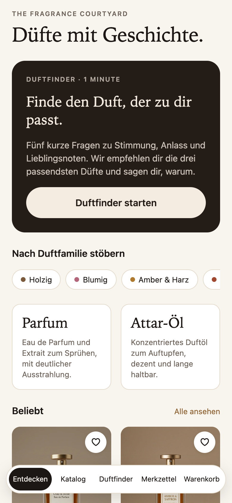
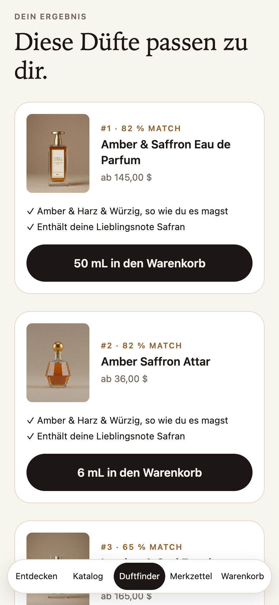
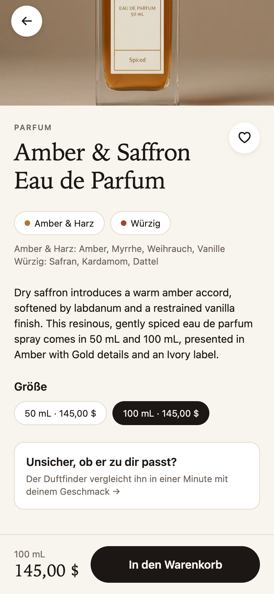
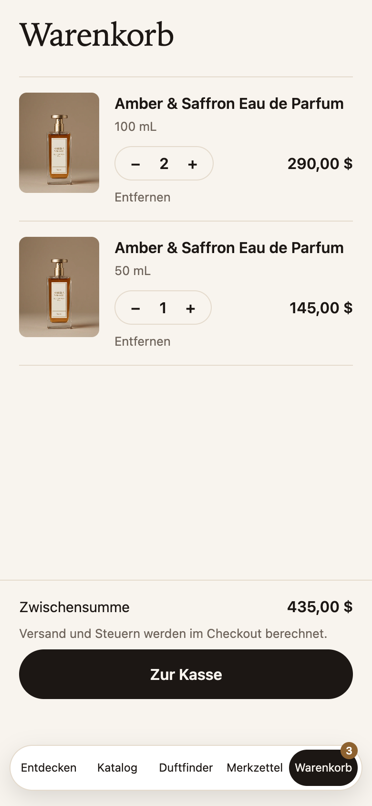

# Courtyard – Fragrance Shopping App

A mobile shopping app for a fragrance brand, built with **Expo / React Native** on top of the **Shopify
Storefront API**. Its centrepiece is a **scent finder**: five short questions, three personal recommendations,
each with a match score and a plain-language reason.

<p>
  
  
  
  
</p>

## Why this app

Fragrance is hard to buy online: you can't smell it. Shops compensate with long descriptions that most
customers don't read, and many give up before buying. This app turns the decision into a one-minute
conversation and explains every suggestion, so customers buy with more confidence – and the brand gets a
direct channel to them on their phone.

Shopify already offers apps for this, so why build it? A brand that wants its **own** app with its own
look, its own recommendation logic and its own data needs custom code on top of Shopify's APIs. That is
exactly what this project shows: Shopify stays the commerce backend (products, stock, cart, checkout),
everything customer-facing is the brand's own.

## Features

- **Scent finder** – mood, occasion, season, intensity and up to three favourite notes. Recommendations come
  with a match score and the reasons behind it ("woody & spiced, the way you like it", "contains saffron").
- **Catalogue** – filter by scent family and format (perfume or attar oil), sort by price, search by name or note.
- **Product page** – scent families with their typical notes, size selection with live price, add to cart.
- **Real Shopify cart and checkout** – cart lines are created, updated and removed through the Storefront
  Cart API; checkout opens Shopify's hosted checkout.
- **Wishlist and persistent cart** – both survive app restarts; only the cart id is stored on the device,
  Shopify stays the source of truth for its contents.
- **iOS, Android and web from one codebase** – native tab bar on phones, a custom floating tab bar on the web.
- **Light and dark mode, accessibility labels** on all interactive elements.

## How the scent finder works

Every answer adds weights to scent families (e.g. *warm & enveloping* → amber/resin +3, spiced +2).
Each product is scored from the tags Shopify already provides:

```
score = Σ weights of the product's families
      + 3 per favourite note found in its tags
      + 2 if its format matches the chosen intensity (subtle → attar oil, strong → perfume)
```

The match percentage compares that score with the **best score possible for these answers**, so it means
something on its own instead of always showing 100 % for the first result. Results are picked greedily
with a small penalty for repeating the same families, which favours real alternatives when scores are close.
The logic lives in [`src/lib/scent/finder.ts`](src/lib/scent/finder.ts) as pure functions and is unit tested.

## Architecture

```
src/
  app/                 Screens (Expo Router, file-based routing)
    (tabs)/            Start, catalogue, scent finder, wishlist, cart
    product/[handle]   Product page, pushed over the tabs
  components/          UI building blocks (cards, chips, buttons, screen layout)
  lib/
    shopify/           Storefront API client, product queries and mapping, React Query hooks
    cart/              Cart API (create / add / update / remove) and Zustand store
    wishlist/          Persisted wishlist store
    scent/             Scent families, formats and the recommendation logic
```

| Choice | Why |
|---|---|
| **Expo + Expo Router** | One TypeScript codebase for iOS, Android and web; file-based routing like on the web |
| **Shopify Storefront API (GraphQL)** | The public API Shopify provides for custom storefronts and apps |
| **TanStack Query** | Caching, retries and loading/error states for server data; opening a product from a list is instant |
| **Zustand** | Small, explicit client state for cart and wishlist, persisted with AsyncStorage |
| **No UI kit** | A small set of own components keeps the brand look consistent and the bundle small |

## Getting started

Requires Node.js 22.13 or newer.

```bash
npm install
npx expo start          # press i / a for a simulator, or scan the QR code with Expo Go
npx expo start --web    # run in the browser
```

The app works without any account: by default it uses **mock.shop**, a public demo store that Shopify
provides with the real Storefront API. To connect a real store, copy `.env.example` to `.env` and set the
store's Storefront API URL and public access token.

## Quality

```bash
npm test                # Jest unit tests for finder, mapping, API client and cart
npm run typecheck       # TypeScript, strict mode
npx expo lint           # ESLint (Expo config)
npm run format:check    # Prettier
```

GitHub Actions runs all of these plus a web build on every push. The main user journey (scent finder →
add to cart → catalogue filter → wishlist → product size → cart quantity → reload) was also walked through
end to end in a browser against the live mock store.

## Possible next steps

- Shopify **Checkout Kit** for a native in-app checkout instead of the browser
- Push notifications for restocks and new releases (needs a small backend)
- Customer accounts via the Customer Account API, with order history
- Learning from purchases: weight the finder by what customers with similar answers actually bought
